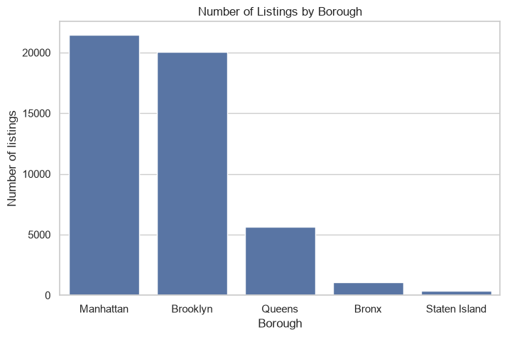
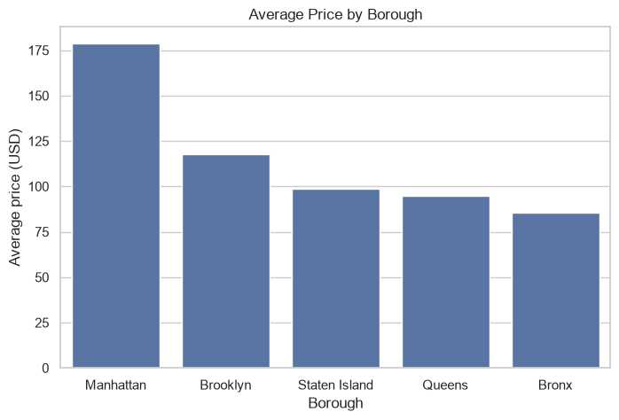
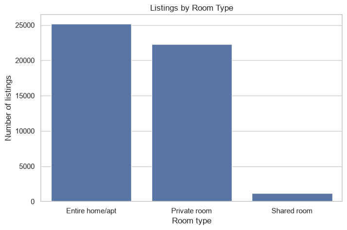
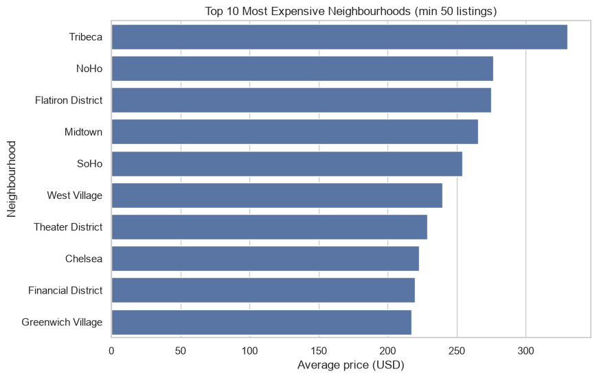
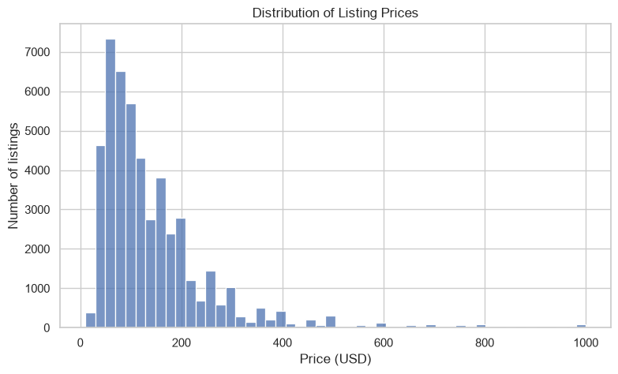

# NYC Airbnb Data Cleaning and Analysis

Cleaned and analysed 48,895 NYC Airbnb listings using Python (Pandas, NumPy, Matplotlib) to understand prices, room types and neighbourhoods.

## Dataset
NYC Airbnb Open Data (AB_NYC_2019), Kaggle.

## Tools
Python, Pandas, NumPy, Matplotlib, Jupyter Notebook (VS Code)

## Data Cleaning
- Started with 48,895 rows, 48,631 remained after cleaning (264 removed)
- Removed 11 listings with price = 0
- Removed 239 listings with price above 1000
- Removed 14 listings with minimum_nights above 365
- Checked for duplicate rows and duplicate IDs: none found

## Key Findings
1. Manhattan and Brooklyn together hold about 87% of listings (21,482 and 20,035).
2. Manhattan is the most expensive borough (average price 178.9), the Bronx the cheapest (85.4).
3. Manhattan's average price is about 2.1 times the Bronx's.
4. Entire homes/apartments are about 52% of listings, private rooms about 46%, shared rooms about 2.4%.
5. Prices are right-skewed: most listings are low-priced, a few expensive ones pull the average up.

## Charts

## Files
- `airbnb_analysis.ipynb`: full analysis notebook
